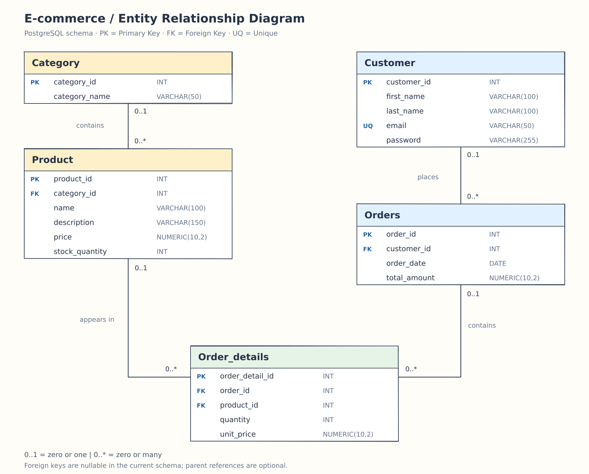

# E-commerce Database Task

E-commerce database task using PostgreSQL and MySQL, covering schema design, entity relationships, ERD, reporting queries, and denormalization.

## Sample Entities

| Entity | Attributes |
| --- | --- |
| Category | `category_id`, `category_name` |
| Product | `product_id`, `category_id`, `name`, `description`, `price`, `stock_quantity` |
| Customer | `customer_id`, `first_name`, `last_name`, `email`, `password` |
| Order | `order_id`, `customer_id`, `order_date`, `total_amount` |
| Order_details | `order_detail_id`, `order_id`, `product_id`, `quantity`, `unit_price` |

The physical table name is `Orders` because `ORDER` is a reserved SQL keyword.

## Tasks

Given the sample entities:

1. Create the database schema script.
2. Identify the relationships between entities.
3. Draw the ERD diagram.
4. Write an SQL query to generate a daily report of total revenue for a specific date.
5. Write an SQL query to generate a monthly report of the top-selling products in a given month.
6. Write an SQL query to retrieve customers who have placed orders totaling more than $500 in the past month. Include customer names and their total order amounts. **[Complex query]**
7. Explain how to apply denormalization to the Customer and Order entities.

## 1. Database Schema Scripts

- [PostgreSQL schema](schema_postgresql.sql)
- [MySQL schema](schema_mysql.sql)

### PostgreSQL Setup

1. Execute `CREATE DATABASE ecommerce;` separately, outside a transaction.
2. In DataGrip, connect to the `ecommerce` database.
3. Run the remaining table creation statements in `schema_postgresql.sql`.

### MySQL Setup

Run `schema_mysql.sql` on MySQL 8.0.16 or later. The script selects the database using `USE ecommerce;` and uses InnoDB tables.

IDs are supplied manually in both scripts; automatic ID generation is not configured.

## 2. Entity Relationships

| Parent | Child | Relationship | Foreign Key |
| --- | --- | --- | --- |
| Category | Product | One-to-many | `Product.category_id` → `Category.category_id` |
| Customer | Orders | One-to-many | `Orders.customer_id` → `Customer.customer_id` |
| Orders | Order_details | One-to-many | `Order_details.order_id` → `Orders.order_id` |
| Product | Order_details | One-to-many | `Order_details.product_id` → `Product.product_id` |

Orders and Product have a many-to-many relationship through Order_details, which stores the quantity and unit price for each order line.

In the current scripts, foreign key columns are nullable, so a child row can have no parent reference. A parent can have zero or more child rows.

## 3. ERD Diagram



## PostgreSQL Reporting Queries

The following queries are the submitted PostgreSQL solutions. The monthly examples use explicit date ranges.

## 4. Daily Total Revenue

**Task:** Generate a daily report of total revenue for a specific date.

```sql
SELECT o.order_date, SUM(od.quantity * od.unit_price) AS total_revenue
FROM Order_details od
INNER JOIN Orders o ON od.order_id = o.order_id
WHERE o.order_date = CURRENT_DATE -- or any specific date
GROUP BY o.order_date;
```

This example reports today's revenue. Replace `CURRENT_DATE` with a date such as `DATE '2026-10-31'` to report a specific day.

Revenue is calculated using the unit price stored in the order details at the time of purchase. If no matching order details exist, this grouped query returns no rows.

## 5. Monthly Top-Selling Products

**Task:** Generate a monthly report of the top-selling products in a given month.

```sql
SELECT p.name, SUM(od.quantity) AS top_products
FROM Order_details od
INNER JOIN Product p
    ON od.product_id = p.product_id
INNER JOIN Orders o
    ON od.order_id = o.order_id
WHERE o.order_date >= '2026-10-01'
  AND o.order_date < '2026-11-01'
GROUP BY od.product_id, p.name
ORDER BY top_products DESC;
```

This example ranks products by total units sold during October 2026. It includes all products sold in the period, ordered from highest to lowest quantity.

## 6. Customers with Orders Totaling More Than $500

**Task:** Retrieve customers who have placed orders totaling more than $500 in the past month. Include customer names and their total order amounts. **[Complex query]**

```sql
SELECT c.customer_id, c.first_name, c.last_name,
       SUM(o.total_amount) AS total_amount
FROM Orders o
INNER JOIN Customer c
    ON o.customer_id = c.customer_id
WHERE o.order_date >= '2026-09-01'
  AND o.order_date < '2026-10-01' -- or any month
GROUP BY c.customer_id, c.first_name, c.last_name
HAVING SUM(o.total_amount) > 500;
```

This solution uses September 2026 as an explicit example month. Update the boundaries to the required past month; the query does not calculate that month automatically.

Orders are summed directly to avoid repeating an order's total for every order-detail row. Grouping by customer ID keeps customers with identical names separate.

## 7. Denormalization: Customer and Order

We can apply denormalization in two ways:

- Add `orders_total_amount` to `Customer` to store the total value of each customer's orders. Recalculate it daily, since the business accepts delayed updates.
- Add `customer_name` to `Orders` to store the customer's name at the time of purchase. Keep it unchanged if the customer later changes their name.

**Benefits:** Faster reads, fewer joins, and less repeated calculation.

**Trade-offs:** Extra storage and daily updates to keep customer totals accurate.

